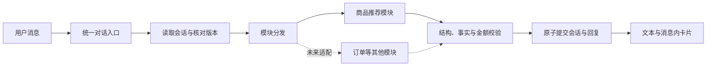

# 第 1 步：会话、模块接口与统一消息协议

## 1. 已确定的产品边界

最终界面是客服对话界面。推荐商品与组合方案作为客服消息内卡片呈现；不设置独立推荐侧栏。原始模型输出、筛选日志与计算过程保留在服务端调试信息中，不默认显示在客服界面。

首个模块为 `product_recommendation`。未来可接入订单查询、优惠咨询等模块；本阶段不实现这些模块，也不显示尚未实现的能力。已有订单模块通过适配器接入，保留原有接口与数据，不在本阶段直接修改。

不依赖 Coze；不包含真实订单交易、支付、登录与人工转接。

## 2. 职责与模块接口

模块不得直接读写前端会话或提交全局状态。模块接收隔离的当前会话快照、本轮消息、时间快照以及本模块状态，返回候选回复、候选模块状态和独立调试信息。调用方提供深拷贝或只读视图，统一入口校验后才提交。

接口见 `runtime/module_interface.py`。`handle` 为异步接口，便于以后接模型与数据库；本阶段只定义接口。

本轮只有一个主模块执行。用户同时问跨模块问题时，未来分发器应请求选择或明确安排处理顺序，不能把多个模块共享状态混写。该行为将在模块分发实现时验收。

## 3. 请求协议

`chat-request.schema.json` 固定以下字段：

| 字段 | 含义 |
|---|---|
| `schema_version` | 当前固定为 `1.0` |
| `conversation_id` | 已有会话 ID；新会话为 `null` |
| `request_id` | 一次发送的唯一标识；重试使用原标识 |
| `expected_revision` | 客户端已知的会话版本；新会话为 0 |
| `message` | 用户文本，去空白后非空，长度上限 2000 字符 |
| `selected_reference` | 可选的历史消息、方案、SKU 引用，避免“第二个”指代漂移 |

用户请求不接受任意系统提示词、会员等级、用户身份、券资格或模型配置字段。未来身份由服务端可信上下文传入，不能从用户文本或前端字段直接覆盖。

请求中的引用必须在当前会话的历史结果中存在，且对应稳定的方案 / 商品标识。普通“第二个”由推荐模块结合最后展示顺序解析；界面点击卡片时可以传稳定引用。不存在或已失效的引用需要澄清。

## 4. 统一回复

`chat-response.schema.json` 使用同一外层封装，前端不根据模块私有字段猜测界面状态。

| `status` | 含义 | 推荐卡片 |
|---|---|---|
| `completed` | 成功完成商品推荐 | 1–3 个 |
| `needs_clarification` | 需要补充、确认或解决冲突 | 0 个 |
| `no_match` | 当前没有符合条件的方案 | 0 个 |
| `unsupported` | 当前未接入对应能力 | 0 个 |
| `error` | 技术异常，当前请求未成功提交 | 0 个 |

`message` 始终包含可读文本；卡片使用明确类型，当前只注册 `recommendation_plan`。未来增加卡片类型时扩展注册表和协议版本，不能由模型输出任意 HTML。界面遇到未知卡片类型时保留可读文本并忽略不认识的卡片。

回复中的 `clarification` 在追问状态下必须存在，最多询问两个字段；其他状态为 `null`。`error` 只在技术异常状态存在，包含稳定错误码和是否可重试，不返回密钥、堆栈或原始供应商错误。

完成、追问、无匹配及未支持状态都是成功处理的对话结果，提交后版本加 1。技术错误不提交本轮结果，不增加版本。

首次请求失败时，会话 ID 为 `null`，不生成可继续使用的虚假会话；客户端保留原请求 ID，仍按新会话请求重试。已有会话出错时保留原会话 ID 和当前版本。

## 5. 推荐卡片与价格

每张卡片表示购买方案，不把组合硬塞成单品。方案类型包括单品、同款多件、组合、凑单和送礼。方案必须明确 SKU、数量、单价、排名、理由、条件与金额明细。

字段关系：

1. `subtotal_fen = Σ(unit_price_fen × quantity)`。
2. `merchandise_payable_fen = subtotal_fen - Σ(discounts.amount_fen)`。
3. 已知运费时，`total_payable_fen = merchandise_payable_fen + shipping_fen`。
4. 运费未知时，`shipping_fen` 与 `total_payable_fen` 均为 `null`，不能展示成确定的整单总价。
5. 不允许负金额、浮点分金额、零数量、重复 SKU 或同类重复优惠 ID。不同类型优惠的标识分别命名，优惠不得超过商品原价合计。
6. `confirmed` 表示针对当前演示数据与明确假设已确认，不能解释为真实商城已核验；条件未确认时为 `conditional`；应付金额无法计算时为 `unknown`，应付字段用 `null`。
7. `conditional` / `unknown` 必须给出条件说明。存在条件待确认的优惠不能标为 `confirmed`。
8. 同一轮方案排名连续为 1、2、3，卡片顺序必须与排名一致，方案 ID 不重复。

回复文本与卡片必须来自同一份方案数据。协议校验只能检查结构与算术；商品事实、优惠范围、计算顺序、用券资格、硬约束与话术金额对照属于第 2–3 步的业务校验。

## 6. 多轮需求状态

`session-state.schema.json` 将商品推荐状态独立保存，不把整段聊天当作唯一记忆。

需求按 `need_groups` 分组，每组有稳定 `group_id`、对象 / 用途描述、预算和约束列表。例如“同事不吃辣，我自己喜欢辣”对应不同需求组，不能合成全局排除项。

预算分别记录：最低 / 最高金额、严格 / 近似 / 未知、单件 / 单份 / 商品合计 / 含运费整单 / 未知口径。口径不清且影响计算时应追问，不自行默认。

约束记录字段、包含 / 排除关系、硬 / 软要求、归属组、原始表达、来源轮次及 active / pending / removed 状态。预算上限低于下限不能成为有效预算；保留原话并进入澄清，避免把矛盾直接写进有效状态。

更新约定：

- 新增要求：保留未被修改的旧条件。
- 明确替换：只覆盖对应条件，例如“预算改成 60”替换预算，不清除口味。
- 明确撤销：旧约束标为 removed；“不是送人”同时清除原送礼标识及由其推导的礼盒偏好。
- 推测偏好：只能保存为软偏好，不升格为用户明确要求。
- 冲突：原始信息保留，待澄清条件标为 pending，不自行选择。
- 切换模块：保留原模块状态；新模块不自动继承商品模块的预算或对象。
- 重新开始：创建新会话 ID，版本归零；旧会话未完成结果不能写入新会话。

这些约定在本阶段定义；提取、更新及冲突判断在第 3 步实现和测试。

## 7. 重试、并发与过期结果

采用“一次发送一个 request_id + 乐观会话版本”的约定：

1. 先查幂等记录。相同会话、相同请求 ID、相同请求内容返回已保存结果，不重复调用模型、不重复加版本；ID 相同而内容不同返回 `request_id_conflict`。新会话以 request_id 关联首次创建的会话，重试不得创建第二个会话。
2. 核对 `expected_revision` 是否等于服务端当前版本。不同则返回 `revision_conflict`，客户端刷新状态后再发送，不能原样无限重试。
3. 读取状态后执行模块。提交前再次核对版本；其他请求已提交时，不得覆盖其结果。
4. 每次成功提交同时保存用户消息、回复、模块状态、最后展示顺序和请求幂等结果，版本只加 1。
5. `base_revision` 是本响应使用的服务端基础版本；正常响应 `revision = base_revision + 1`；错误响应 `revision = base_revision`。版本冲突错误携带当前服务端版本。
6. 前端只展示当前会话且与待处理请求匹配的结果；忽略已切换会话或过期请求的结果。
7. 取消前端等待不等于服务端已取消。服务器是否提交以幂等记录与版本为准。

本阶段没有实现会话存储、事务、并发提交或幂等缓存，不能宣称已完成并发测试。

## 8. 第 1 步验收

已纳入本阶段机器检查：正常请求、空消息、未知字段、新会话版本、正常方案、追问、无匹配、错误状态、负 / 浮点金额、金额明细不一致、优惠超额、重复商品 / 方案 / 优惠、排名错误、条件价格状态、未知运费、版本关系、预算类型与区间、模块状态隔离的结构限制。

后续验收：双重否定、程度词、模糊预算、多人需求、多轮覆盖 / 撤销、检索漏召回、字段未知、标签误推断、优惠门槛一分钱边界、商品范围、叠加顺序、过期边界、凑单支出、多轮指代、模型事实编造、提示词干扰、服务异常、并发与界面一致性。第 2 步为这些场景建立数据、预期和失败判据。

## 9. 尚未实现

推荐服务、模型客户端、检索、商品和优惠数据、业务计价规则、会话存储、接口路由、订单适配器、网页及部署。协议案例是假设数据，只验证格式和算术，不代表实际推荐结果。
