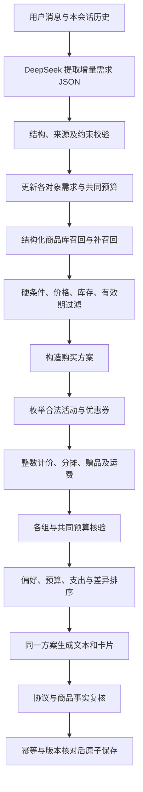

# 第 3 步：商品推荐核心与模型接入层

> 本文记录第三步完成时的状态。第四步已完成客服网页及有限场景真实 DeepSeek 核验，最新结果见《07-客服界面与第四步核验》。下文“尚未执行”指第三步当时。

## 完成范围和证据

已实现推荐核心、DeepSeek 调用代码和持久化会话入口。第 4 步网页尚未开始，第 5 步真实模型及完整链路验收尚未执行。

信心划分：

- **高**：已执行测试覆盖的计价、约束过滤、多轮状态、错误不写入和并发版本核对。
- **未知**：真实 DeepSeek 对否定、歧义、指代和注入的理解效果；脚本模型测试不能证明自然语言准确率。
- **未验证**：网页呈现、真实网络延迟及全部 98 个完整业务场景。

执行证据在 `acceptance/stage3_execution.json`，由 `tools/verify_stage3.py` 实际运行测试后生成。计价测试包含 53 个事先固定的数值基准子检查；测试方法数与业务场景数不是同一口径，不能相加当作完整验收案例数。

## 推荐流程

模型负责理解需求，不计算金额、不改身份、不宣布券资格。最终文本由已核验方案生成，没有再增加一个自由编写价格与商品事实的模型节点。

澄清时模型选择最多两个字段，由程序生成提问措辞，避免追问中夹带商品承诺。错误结构、未知谓词和虚构原话来源允许一次定向修复；再次失败返回 `invalid_model_output`，不展示卡片、不保存状态。

## 需求、多轮状态与过滤

每项条件保留原话、来源轮次、强度、explicit / inferred 来源。补丁分别新增、替换、撤销，不把整个旧需求覆盖成当前一句话。

- 改预算保留包装、口味、数量；撤销送礼递归撤销其推测依赖，保留独立明确礼盒要求。
- 不辣、微辣可接受、不甜、低糖、无糖分别处理；黑巧名称不能推导糖标签。
- 普通不喜欢花生与过敏排除分开；过敏检查声明和可能含有信息。
- 不同对象单独建组，共同预算保存一次。同一订单统一计价，不能分组重复用券。
- 矛盾口味/数量先问；金额口径不明先问。没有预算但已知条件足够可以继续推荐。
- 明确条件的来源必须是当前消息原文。原文存在不能证明句义理解正确，仍需真实模型验收。

当前事实库为本地 JSON，没有部署向量数据库或真实商品 RAG。召回只提供 SKU 线索，程序去重并补扫有限商品库，避免首次空召回就误判无商品。

名称、价格、库存、日期、糖标签以结构化资料为准。用户和检索文字中的“系统通知”不能写回身份或价格。相关字段未知时不能满足硬要求；不相关字段未知不自动否决商品。无价、未知库存、缺货和过期商品不能成为确认可购买项，异常商品单条隔离。

独立包装检查内包装；独立小包要求已知内包 <=30g。礼盒内明确坚果内容受坚果排除约束，种子不自动算树坚果。临期按上海本地日期距到期 <=30 天判断，允许的临期备选明确说明。

## 计价与排序

`runtime/pricing.py` 独立实现生产计价，不调用 `acceptance/reference_probe.py`。测试读取预先固定的手算结果来核对生产输出。

已实现：

- 开始包含/结束不包含的统一时间快照，新老客、会员、渠道及 unused 持券资格。
- 活动与券的品类/SKU 范围交集，最多一个活动和一张券，双方允许才叠加。
- 枚举合法组合和无优惠方案；活动按原始参与金额，券按活动分摊后的参与金额核对门槛。
- 整数半入、封顶、最大余数分摊及 SKU 稳定破平局，不使用浮点金额。
- 秒杀两件上限，赠品单独保存、只赠一次，购买与赠品合并核对库存。
- 赠品核对适用的硬排除、口味、内包装与非临期要求，不合格赠品活动退出。
- 优惠后计算包邮。未知区域保留未知运费/总价，不能证明严格整单预算符合。
- 严格预算不放宽；近似预算偏离明示。软下界不强迫花满；明确硬下界必须满足。
- 每件/每份预算用行应付与数量比较，不用取整均价判门槛。
- 跨组同 SKU 聚合库存；优惠后的商品行金额按组分摊再核对各组预算。

排序先满足硬条件，再比较明确偏好、场景/推测、预算目标、确认程度和同口径支出；历史仅作弱参考。主要商品相同的方案不重复占据三张卡。

软偏好未完全满足、临期、偏离近似预算及未知运费会说明。文本与卡片共用同一方案，并再次核对名称、单价、优惠、赠品和金额。

## 可选凑单

默认不为促销额外购买。只有用户明确同意才激活 `add_on_allowed`，与“不多买”或“恰好 N 件”冲突时澄清。

凑单展示不凑单基线、增加件数、重新计算后的金额及总支出变化。已验证的局部测试价格例子：基础商品 98 元，加运费总支出 104 元；加入 6.90 元商品触发活动后，商品应付 94.90 元、运费 6 元、整单 100.90 元，新增一件、总支出少 3.10 元。不能把名义优惠当成含运费支出节省。

领券接口尚未接入。低层计价器支持明确标注的待领取条件券，但推荐主流程只使用已确认持券，不用未确认券证明严格预算。

## 会话与异常

SQLite 保存会话、历史、成功请求和诊断。等待模型时不持有事务。

- 相同请求相同内容重放原响应；同 ID 不同内容为 `request_id_conflict`。
- 旧版本/并发更新为 `revision_conflict`，报告当前版本。候选不能覆盖新状态。
- 超时、模型失败、资料失败或事实不符不追加历史、不改需求；失败可用相同 ID 重试。
- 卡片引用必须属于当前所有者、会话和真实历史方案/SKU；选中旧卡片重新计价。
- 新会话不继承旧需求。未接入订单、退款或人工接口明确 unsupported。

取消等待在尚未进入提交时中止本轮；已完成服务端操作以保存结果为准。浏览器取消、重试、输入保留和版本同步留到第 4–5 步验证。

## Demo 范围

当前推荐器采用有限候选搜索，不能宣称任意规模的全局最优：

- 最多三个需求组。同组 <=12 件最多三个 SKU，13–20 件最多两个 SKU，更大数量先考虑同款。
- 默认取满足数量约束的基础量；额外量只在明确凑单许可时考虑。
- 凑单支持单组，最多加一种新 SKU、一至两件。
- 最多 5000 个候选分配；超过上限或组合形状受限而不能排除存在解时澄清，不误报无匹配。
- 多对象含运费预算采用共同订单预算；分组是否拆单不清时先问。
- 无真实订单、领券、支付、登录、人工服务；现有订单项目保持独立，待后续适配。

## 已生成的离线样例

输入：办公室吃，必须独立小包，不辣，不要坚果，不要临期，最好低糖，买三件，含运费最多60元。

`examples/need-office.json` 中的需求补丁由人工明确给出，**未经过真实模型提取**。核心实际结果为：

| 选择 | 商品 | 商品应付 | 运费 | 整单 |
| --- | --- | ---: | ---: | ---: |
| 首选 | 燕麦小饼干 ×3 | 38.70 | 6.00 | 44.70 |
| 备选 1 | 无糖薄荷糖 ×1、低糖谷物棒 ×2 | 53.70 | 6.00 | 59.70 |
| 备选 2 | 燕麦小饼干 ×1、无糖薄荷糖 ×2 | 28.70 | 6.00 | 34.70 |

首选完全匹配低糖标签，备选注明未完全匹配，不把无糖商品写成低糖标签商品。三项是购买三件的互斥选择，不是要买九件。完整输出见 `examples/stage3-offline-result.json`。

## DeepSeek 配置及下一阶段

2026-10-07 查阅官方 [首次调用](https://api-docs.deepseek.com/)、[JSON 输出](https://api-docs.deepseek.com/guides/json_mode/) 和 [Chat Completions](https://api-docs.deepseek.com/api/create-chat-completion/) 后，适配器默认官方 HTTPS 地址、`deepseek-flash` 模型、JSON 输出和非思考模式。可本地修改模型名称；这不证明你的账户已经能调用该模型。

在项目根目录按 `.env.example` 创建 `.env`，本地填写 `DEEPSEEK_API_KEY`。进程环境优先于文件。密钥不进入模型消息、浏览器、响应或诊断。供应商错误正文不回传，认证头不跟随重定向。

`python -m runtime.cli --check-config` 只报告是否配置，`--message` 才发送真实请求。脚本模型和模拟网络只存在于测试中，运行时没有伪装成 AI 的备用规则模型。

当前没有配置密钥，真实调用次数为零，语言准确率留空，98 个全文业务场景没有标成整体通过。第四步做客服对话界面，第五步验证真实模型和网页完整链路，重点复测否定、过敏、预算、指代、多对象、注入和故障。
