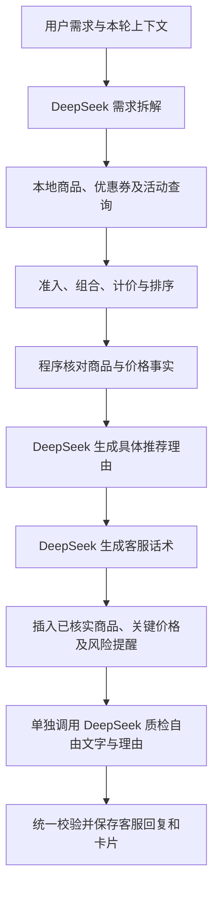

# 补齐原工作流的推荐解释与客服话术

上一版网页直接输出购买方案与金额列表，虽然核心计算可核对，但缺少原工作流的“推荐理由 → 客服话术 → 最终质检”表达链路。这是实现遗漏，本次已补齐。

本文及截图记录当时的历史效果。后续规则已改为一律排除临期，旧截图中临期提示与相应方案不代表当前规则。最新接入与验证见 [订单整合记录](10-订单模块整合与临期规则验收.md)。

## 与原流程的对应关系

依据原始导出的参考资料 `../workflow_review/original_workflow.yaml` 与解析后的 `workflow.json`，三段原模型节点分别为：

| 原节点 | 原提示词的主要要求 | 本次实现 |
| --- | --- | --- |
| 推荐理由，144514 | 依据商品信息和用户需求，生成可理解的理由；不得编造销量、优惠或功效 | `prompts/recommendation_reasons.md` 与 `ReplyGenerator` 的理由阶段；每个已排序方案生成两条简短理由，并引用该方案自己的事实编号 |
| 客服话术生成器，142350 | “亲～”开头、一个表情；先回应需求，解释主推和备选差异，说明预算和风险，友好引导 | `prompts/customer_reply.md`；DeepSeek 生成正文，正文通常选一条主要理由，其余理由放在卡片里 |
| 安全与合规检查，165543 | 检查虚构事实、夸大、违背要求、预算与表达 | `prompts/reply_review.md`；单独调用 DeepSeek 检查新生成的理由和自由文字，程序继续核对方案和金额 |

参考文档作为业务资料使用，不运行 Coze。原流程每商品 2–3 条理由，在已有单品/多件/组合卡片协议下调整为每方案两条理由，分别引用方案内商品的事实；避免一个组合里的每个商品都重复三条长理由。品牌沿用当前界面的“拾味”，保留原提示词的“亲～”和一个 😊。

最终流程：

## 回复的变化

- 正文先回应用途、关键偏好和预算，再解释首选为什么适合。
- 备选说明真实的商品组合变化和总价差异，不能凭空声称口感更好或更饱腹。
- 正文展示关键价格；单价、商品合计、运费和优惠明细继续由卡片展示，减少重复报账。
- 每张卡片的理由由模型根据实际商品生成，不再只有“符合硬条件”“便于比较支出”等通用句子。
- 临期日期使用 `2026年10月20日` 等自然格式，必要风险不会因话术润色被省略。
- 运费未知时只给商品应付，明确整单金额待确认。
- 引导仅使用界面已有动作：选中卡片上的商品，继续调整数量、预算或搭配。没有商品详情页或下单接口，不让话术引导这些不存在的操作。

模型不能修改候选商品、数量、价格、优惠或排序。话术中的关键事实由占位符插入；复述预算和本轮已推荐商品时也核对来源。临期、预算偏差、优惠和运费提醒必须保留。质检只检查新生成文字，不能擅自重判已经核实的计价和业务边界。

理由与话术各最多修复一次；持续失败或超时会返回明确错误，本轮不保存、不显示成功卡片，不用旧模板冒充模型回复。连接类失败最多再尝试一次；授权失败和限流不会无限重试。正常的完成推荐会包含需求理解、理由、话术、质检四次模型调用，因此比上一版单次理解调用更慢。

## 已执行核验

当前工作区 **205 项自动测试全部通过**，其中本次新增 14 项理由/话术/会话检查和 2 项模型适配检查；总数也包含工作区已有的模块统一边界测试。生产计价仍通过 53 个预先固定的数值基准，不能把这些基准与测试方法数相加当成完整业务场景数。

新增检查包括：

- 理由引用错误或跨方案事实、购买件数与种类数混淆。
- 编造价格、新增本轮方案之外的商品、遗漏理由或改变顺序。
- 正确复述预算可以通过，错误预算不能通过。
- 临期提醒不能删，运费未知不能说整单价已确定。
- 质检失败后限次重写；持续失败不提交会话。
- 回复与卡片保存一致；相同请求重试不再生成一次。
- 模型请求使用独立的理由、话术和质检提示词；连接失败仅限次重试。

真实浏览器执行了四轮完整链路，并核对后端提交记录：

| 场景 | 核对结果 |
| --- | --- |
| 办公室、独立小包、不辣、不要坚果及临期、优先低糖、三件、含运费最多60元 | 正文与卡片都有具体理由；首选三件燕麦饼干含运费44.70元，备选保持原排序与价格 |
| 选中首选商品，改为两件，含运费最多40元 | 只保留选中 SKU，重新计价为31.80元，生成本轮客服话术 |
| 办公室、不辣、两件、含运费最多20元，含临期备选 | 展示17.80、19.80、18.80元方案，并说明临期燕麦饼干标注到期日为2026年10月20日 |
| 演示资料待确认身份，指定燕麦饼干一件，商品预算20元 | 仅确认商品应付12.90元，运费及整单金额待确认，没有冒充已确定总价 |

每轮后端诊断均记录 `deepseek_reasons_composition_review`，理由与最终质检实际执行并通过。第一轮话术修复一次后通过，其余三轮直接通过。桌面和手机布局均已查看实际截图。

证据文件：

- `acceptance/reply_execution.json`：自动测试与四轮实际模型链路审计。
- `acceptance/stage4-browser-reply.json`：真实浏览器回复文本、理由、金额和请求编号。
- `examples/screenshots/desktop-natural-reply.png`：桌面推荐话术。
- `examples/screenshots/desktop-low-budget-reply.png`：对应用户反馈的低预算与临期备选。
- `examples/screenshots/mobile-natural-reply.png`：手机视口。

运行 `python tools/verify_reply.py` 可以重跑离线检查并核对已保存的浏览器证据与后端诊断；它不重新调用模型。浏览器实测需独立测试 Chrome 及调试端口，由 `tools/browser_verify.mjs reply` 执行，会使用真实接口额度。

**置信度高**：上述已执行链路、金额与卡片一致性。**置信度中**：自由话术和推荐理由的语义质量，模型质检不是确定性证明，措辞仍可能需要迭代。本文记录的是话术优化阶段的四轮实测；后续完整98场景执行与未通过项见 [第五步验收记录](09-第五步业务验收.md)，不提供自然语言整体准确率。

## 查看新效果

打开 `http://127.0.0.1:8787/`，刷新页面后点击“开始新的咨询”，再输入需求。历史消息保持原样，不会把已保存的旧回答悄悄改写成新版；新发送的推荐需求走新的理由与话术链路。

追问、无匹配及未接入模块仍使用现有明确回复。本次改动针对有合格商品方案时的推荐表达，没有将其它模块伪装成已接入。
