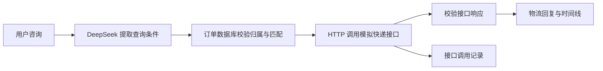

# 小食光 · 独立零食订单客服

这是根据原始订单查询工作流重构的本机演示项目。前端、查询服务和 SQLite 数据库均独立运行；DeepSeek 配置后承担意图识别、参数提取、依据检索话术生成客服回复以及独立质检。

订单话术独立放在 `order_reply/`，商品推荐模块维护自己的回复链路。页面右侧“订单模块：话术检索与回复生成”可查看本轮检索命中、生成与质检记录。[模块维护说明](order_reply/README.md)。

目前使用 **10 笔虚构订单、2 个演示账号**。用户 A 有 9 笔订单，用户 B 有 1 笔。订单、金额、手机号、运单和物流时间均为演示数据，不能作为真实商城查询结果。

## 打开演示

需要 Python 3.10 或以上版本；运行服务不需要安装第三方 Python 包。

1. 解压完整项目，进入 `snack_customer_service` 文件夹。
2. 双击 `start.cmd`，保持运行窗口打开。
3. 浏览器访问 **http://127.0.0.1:8765**。

也可以在此文件夹运行：

```powershell
python app.py --port 8765
```

服务只监听本机地址。端口占用时可改为 `--port 8766` 并访问对应地址。

## 接入 DeepSeek

1. 将 `.env.example` 复制为 `.env.local`。
2. 在本机编辑 `.env.local`，填写 `DEEPSEEK_API_KEY`，不要将密钥发送到聊天或放进交付包。
3. 默认设置如下：

```dotenv
MODEL_ENABLED=true
DEEPSEEK_API_KEY=在本机填写
DEEPSEEK_BASE_URL=https://api.deepseek.com
DEEPSEEK_MODEL=deepseek-flash
DEEPSEEK_TIMEOUT=15
```

4. 运行 `python model_adapter.py` 检查连接和结构化提取。这会发送一条包含虚构订单号的测试消息，消耗少量模型额度。
5. 重启客服服务，配置才会生效。

接入采用官方 `/chat/completions` 接口和 JSON Output，并禁用思考模式用于短参数提取。默认模型名称来自此次核对的官方文档，账户可用模型变化时可修改 `DEEPSEEK_MODEL`。

- [DeepSeek 官方 Chat Completions 文档](https://api-docs.deepseek.com/api/create-chat-completion/)
- [DeepSeek 官方 JSON Output 文档](https://api-docs.deepseek.com/guides/json_mode/)

模型只接收当前咨询文本和提取规则，不接收数据库订单列表或服务端身份。服务端仅使用允许的意图与查询字段，并要求订单号、运单号、手机号和商品名称能在原消息中找到。模型返回的身份、订单状态、SQL 或动作字段均被忽略。

模型未配置、认证失败、超时、接口限流、输出截断或参数编造时，系统使用本地查询规则；响应中的 `engine` 和 `model_status.fallback_reason` 会如实反映处理方式。页面显示实际使用的理解方式。

**当前本机验证：已填写 DeepSeek 密钥并通过真实连接、结构化提取、订单查询和连续追问检查。交付 ZIP 不包含密钥；在其他机器运行时需要单独配置。**

## 已落实的五项修改

| 原问题 | 修改后的行为 | 数据库对应修改 |
| --- | --- | --- |
| 旧 `order_id` 实际是快递运单号，缺少商城订单号和发货状态 | 商城订单号、运单号、订单状态、发货状态分别查询和展示；无运单不会推断为未发货 | `orders.order_id` 存商城号；`shipments.tracking_number` 存运单；保留 `legacy_tracking_number` |
| 首次输入与追问分成四条处理路径，回复标准不同 | 统一执行“理解 → 参数校验 → 身份与订单匹配 → 结果处理 → 回复”，追问和候选选择使用同一查询服务 | 持久化会话条件、结果及消息，支持服务重启后继续查询 |
| 查无订单、物流无轨迹、接口故障混在一起 | 分别返回无匹配、暂无轨迹、查询失败；物流失败仍保留已确认的订单事实 | 订单状态独立于包裹状态，物流轨迹与预计送达来源独立存储 |
| 商品名、查询类型、用户身份没有实际参与查询 | 支持订单号、运单号、下单手机号、商品名；区分是否发货、物流进展、预计送达；每次查询限定为当前账号 | `orders.user_id` 关联用户；商品明细表和索引参与筛选 |
| 没有统一结果，也没有实际转人工动作 | 通过模拟人工 HTTP 接口创建工单、排队、接入坐席并完成处理 | 保存原因、订单、会话、上下文快照、工单状态及接口记录；重复提交不会重复创建工单 |

## 建议这样验收

| 输入或操作 | 预期结果 |
| --- | --- |
| `SN-DEMO-0001 发货了吗` | 已付款、尚未发货；不会声称已催仓库 |
| `DEMO-TRACK-1002 物流到哪了` | 定位商城订单 `SN-DEMO-0002`，展示演示运输轨迹 |
| `我买的牛肉干物流到哪了` | 用户 A 命中两笔，需选择订单 |
| 在选中 `SN-DEMO-0002` 后追问 `那它什么时候到` | 使用当前订单，读取演示数据中的预计送达时间 |
| `SN-DEMO-0004 什么时候到` | 暂无预计送达时间，不推测到货日期 |
| `SN-DEMO-0007 发货了吗` | 发货状态待核实，提供转接模拟人工按钮 |
| `SN-DEMO-0008` | 展示部分发货和两个包裹的信息 |
| `SN-DEMO-0009` | 待付款，不错误描述为已付款待发货 |
| 切换用户 B 后查询 `SN-DEMO-0002` | 没有匹配订单；不能读取用户 A 的订单 |
| 点击转接模拟人工，再查看人工请求 | 通过 HTTP 创建排队工单，可以模拟坐席接入和处理完成 |

预计送达时间来自模拟快递接口；已签收、物流异常或停滞时不会继续展示原来的预计送达时间。

## 模拟快递接口与物流推进

启动客服时会自动启动另一个本机 HTTP 服务，默认监听 `127.0.0.1:8766`。客服实际调用 `POST /v1/traces/query`，传入快递公司编码和运单号，解析返回的物流状态、节点、时间、地点及预计送达。两个服务由启动程序统一管理。



**物流内容是虚构的，HTTP 请求和响应实际发生。当前没有调用顺丰、中通等真实快递企业的查询接口。**

右侧“模拟物流与接口调用”面板支持：

1. 先查询 `SN-DEMO-0002` 或运单 `DEMO-TRACK-1002`，展示揽收、到达分拨中心和运输节点。
2. 在当前包裹中选择“派送中”“已签收”等状态，点击“更新并查询”。状态先写入模拟快递服务的数据库，再重新发起查询，客服读取新轨迹。
3. 选择“超过48小时未更新”或“配送异常”，检验异常提示和人工请求入口。
4. 切换“本次查询的接口场景”为超时、接口错误、暂无轨迹或格式异常，再发送物流查询，查看处理结果。
5. 展开调用记录，查看请求编号、接口地址、参数、HTTP 状态、耗时和响应。认证头不会展示或写入记录。

仅查询是否发货、订单尚未发货或尚未选定一笔订单时，不调用快递接口。多包裹订单会逐个调用；一个包裹失败不会清除另一个成功包裹的轨迹。接口超时、HTTP 错误或响应无效时，保留订单发货事实，同时清空本次未能验证的物流与预计送达。

物流演示采用明确的“模拟业务时间”，状态推进可以进入未来的虚拟业务时刻。页面中的轨迹时间与48小时判断使用该时间；调用记录中的请求时间使用实际北京时间。二者不混用。

快递端独立存储在 `database/mock_courier.sqlite` 的 `parcels`、`provider_requests` 表。客服不读取其中的物流内容，只通过 HTTP 获取结果。订单库新增 `courier_api_calls`，用于将会话、订单和实际请求对应起来；可以用同一个请求编号核对两端记录。

端口占用时可同时指定两个端口：`python app.py --port 8770 --courier-port 8771`。两个端口只监听本机。

## 模拟人工转接接口

启动程序会一并启动第三个本机 HTTP 服务，默认端口为 `8767`，使用独立的 `database/mock_human.sqlite` 保存工单和接口记录。

| 模拟坐席接口 | 功能 |
| --- | --- |
| `POST /v1/handoffs/create` | 按用户与本地请求编号创建工单；相同请求重复提交返回同一工单 |
| `POST /v1/handoffs/query` | 查询排队、坐席接入或处理完成的状态 |
| `POST /v1/demo/handoff-state` | 模拟坐席接入、工单完成等状态推进 |

用户点击“联系人工”或“转接模拟人工客服”后，客服先保存请求与上下文，再通过实际 HTTP 调用模拟坐席接口。传递的信息包括当前咨询、关联订单和最近最多10条对话。订单上下文保留提交时的快照，后续查询其他订单不会修改已提交工单。

右侧“模拟人工转接与接口调用”面板展示请求编号、模拟工单号、排队位置、坐席与状态。点击“模拟坐席接入”后，接口将返回模拟坐席姓名；此后可点击“模拟处理完成”。“刷新工单状态”和历史请求都会按当前登录身份重新查询。

支持正常排队、模拟无人在线、创建超时、HTTP 错误及响应格式异常。无人在线时保持排队，不声称已接入；超时或无效响应时显示“创建结果待确认”。刷新或重试使用同一个请求编号，能够找回已经创建的工单，避免重复创建。已结束的工单不能直接重新排队。

订单库保存 `transfer_state`（`queued`、`connected`、`closed`、`failed`、`unknown` 或旧记录的 `not_connected`）、模拟工单号、排队位置、坐席和接口记录。原有 `status` 字段保留兼容值，页面和接口以 `transfer_state` 为准。

**工单和 HTTP 调用真实发生在本机模拟系统内；“模拟坐席 小林”并非真实工作人员，也没有接入购物平台的实际坐席。**

三个端口可分别指定：`python app.py --port 8770 --courier-port 8771 --human-port 8772`。

## 数据库与旧数据迁移

正式使用的本地数据库为 `database/snack_orders_demo.sqlite`。`database/schema.sql` 定义以下表：

- `users`：演示账号与下单手机号。
- `orders`：商城订单、用户归属、金额、订单状态、发货状态、旧运单字段及待确认标记。
- `order_items`：订单商品明细，支持一单多商品。
- `shipments`：包裹与运单，支持一单多包裹、预计送达时间及来源。
- `tracking_events`：包裹轨迹及记录时间。
- `conversations`、`conversation_messages`：查询上下文与对话。
- `human_requests`、`human_request_conversations`：人工请求及当时查询结果快照。
- `demo_sessions`：服务端演示会话；浏览器 Cookie 不包含身份编号。
- `legacy_order_import`：旧记录原文及迁移待确认标记。
- `courier_api_calls`：快递请求及响应、HTTP 状态、耗时与会话关联。
- `human_api_calls`：人工工单创建、状态查询及状态推进的实际接口记录。

服务启动时自动创建缺少的表，为人工请求补上上下文、转接状态、排队位置、坐席姓名和状态更新时间，为包裹表补上 `carrier_code`，不会覆盖已有订单或人工请求。数据库版本标记为 5。

用户已经确认旧表的 `order_id` 存运单号。迁移程序因此把该值保留为运单，绝不直接充当商城订单号。旧记录缺少真实商城号、发货状态或身份关联时会保留为待确认；无身份映射的记录归入 `legacy_unassigned`，两个演示账号均无法查询。

导出旧表为 JSON 数组后，可迁移到一个单独的新数据库：

```powershell
python -m database.migrate_legacy --input "旧订单.json" --database "database/legacy_orders.sqlite"
```

旧字段应为 `item_title`、`order_id`、`user_phonenumber`。程序保留输入原文，同一记录重复导入不重复新增。没有商城号的记录会生成带 `LEGACY-DEMO-` 前缀的迁移编号，并明确标记待确认。

可选映射：`--identity-map` 为手机号到用户 ID；`--order-map`、`--shipping-map` 为原记录哈希到商城号、发货状态。哈希按字段排序后的 JSON 原文计算。映射应在首次导入前确认；已有映射冲突会回滚。

**原 ZIP 未包含可验证的实际订单记录。本次交付包含新表结构、演示数据和迁移工具；没有声称已迁移真实业务订单。**

## 接口与运行边界

| 接口 | 用途 |
| --- | --- |
| `GET /api/health` | 服务、数据库、模型配置状态；不输出密钥 |
| `POST /api/demo/login` | 切换演示用户，建立本机演示会话 |
| `GET /api/orders` | 当前账号的订单列表 |
| `POST /api/chat` | 咨询、追问、候选订单选择 |
| `POST /api/human/request` | 创建本地请求并通过 HTTP 提交模拟工单 |
| `GET /api/human/requests` | 当前账号的人工请求列表 |
| `POST /api/human/query` | 通过模拟坐席接口查询当前账号的工单状态 |
| `POST /api/demo/human-state` | 模拟坐席接入或处理完成 |
| `GET /api/human/calls` | 当前账号的人工接口调用记录 |
| `POST /api/demo/logistics` | 修改当前账号所属包裹的模拟物流状态 |
| `GET /api/courier/calls` | 当前账号的实际快递接口调用记录 |
| `GET /api/reply/runs` | 当前账号的订单话术检索与生成记录 |

查询结果包含 `schema_version`、`result_type`、`reply`、`reply_status`、`query_type`、`orders`、`candidates`、`next_action`、`human_transfer`、`conversation_id`、`engine`、`courier_calls` 等字段。结果版本为 2.1。客户端传入的 `user_id` 不参与授权。

演示登录允许选择 A/B 账号，这是演示功能。接入真实商城时，需用商城已有登录身份替代该入口，并接入实际订单、物流和坐席接口。当前坐席为模拟服务，页面明确标记“模拟坐席已接入”，不会冒充真实人工或声称已执行退款、通知仓库等动作。

订单与上下文存储在 SQLite；当前页面刷新会开启新对话。后端保留已有会话，并可用原 `conversation_id` 继续查询。

## 验证与文件位置

```powershell
python -m unittest discover -s tests -v
```

人工作业版本曾通过86项自动检查、15项物流与通用查询浏览器检查及10项人工浏览器检查。当前话术版本的实际数量和结果以 `artifacts/reply-verification.json` 为准。自动检查中的 DeepSeek 响应使用替代网络数据；快递与人工测试使用实际本机 HTTP 服务。真实模型及浏览器验证分别记录实际执行结果，不把离线测试算作模型理解准确率。

- `app.py`：本地页面与接口服务。
- `service.py`：统一订单查询和会话处理。
- `model_adapter.py`：DeepSeek 配置、结构化提取和连接检查。
- `order_reply/`：订单模块独立的话术库、检索、生成、质检及维护说明。
- `courier_simulator.py`：独立端口和独立数据库的模拟快递服务。
- `courier_client.py`：快递 HTTP 调用、响应校验和记录。
- `human_simulator.py`：独立端口与数据库的模拟坐席服务。
- `human_client.py`：模拟人工工单创建、查询、状态推进与响应校验。
- `nodes/normalize.py`、`query.py`、`render.py`、`human.py`：通用处理模块。
- `web/`：客服页面。
- `database/`：新数据库、结构、演示数据及旧数据迁移工具。
- `tests/`：接口、业务与模型边界检查。

**置信度：本机演示功能、数据库一致性及真实 DeepSeek 调用，高；真实商城坐席转接，尚未接入。**
